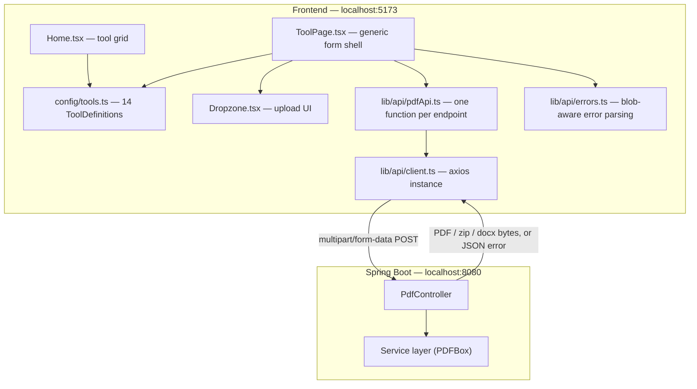
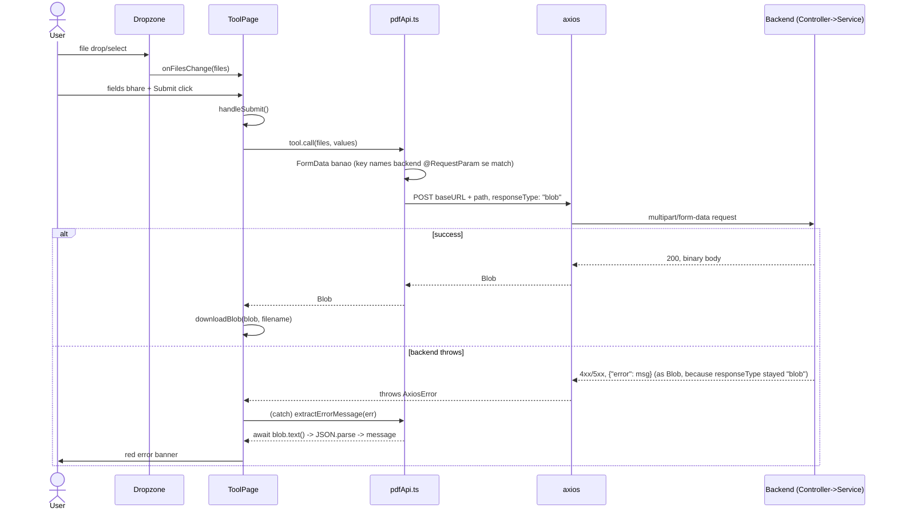

# PDS PDF Frontend — Architecture

React + TypeScript + Vite frontend for the PDS PDF tools, created by Anurag Kumar ("playful colorful" look). Backend is a separate Spring Boot service (see `pds-project-backend/ARCHITECTURE.md`).

## High-level system diagram



**Fundamental idea:** frontend aur backend 2 independent apps hain, sirf HTTP se baat karte hain (client-server architecture). Koi shared code/types nahi — contract sirf URL + request/response shape hai.

## Why config-driven, not 14 separate pages

Shuruaat mein har tool ke liye alag page banana ek option tha (`MergePage.tsx`, `SplitPage.tsx`, ...), par 14 tools ka shape bahut similar hai: file(s) upload karo → kuch optional fields bharo → submit karo → result download/display karo. Isliye:

1. Har tool ko **data** ki tarah describe kiya (`src/config/tools.ts`) — naam, icon, color theme, accept-type, form fields, aur backend ko call karne wala adapter function.
2. **Ek hi** `ToolPage.tsx` component us config ko padh ke UI generate karta hai.
3. Naya tool add karna ab = `tools.ts` mein ek entry + `pdfApi.ts` mein ek function — koi nayi page file nahi.

Yehi pattern **real production apps** mein common hai (Stripe dashboard ke forms, admin panels, CMS-driven UIs) jab bhi "many similar screens, different data" wali situation ho.

## Folder structure

```
src/
  types/
    tool.ts        -> ToolDefinition (ek tool ka pura shape)
    field.ts        -> ToolField (ek form field ka schema)
    pdfInfo.ts       -> PdfInfo (backend ke PdfInfoResponse ka TS mirror)
  config/
    tools.ts         -> 14 tools ki poori config (data, zero UI)
  lib/
    api/
      client.ts       -> axios instance (baseURL)
      pdfApi.ts        -> backend ke har endpoint ke liye 1 function
      errors.ts        -> axios error se readable message nikaalna
    download.ts        -> Blob ko browser download mein convert karna
  components/
    layout/
      Navbar.tsx, Footer.tsx, Layout.tsx (+ <Outlet/>)
    ToolCard.tsx        -> home grid ka ek card
    Dropzone.tsx         -> drag/drop + reorder, accept/multiple configurable
  pages/
    Home.tsx             -> tools.map() -> ToolCard grid
    ToolPage.tsx          -> generic: upload + dynamic form + submit + result
  App.tsx                 -> routes: "/" (Home), "/tool/:toolId" (ToolPage)
```

## Request lifecycle (sequence diagram)

Koi bhi tool chalaate waqt (jaise Rotate) ye poora flow chalta hai:



`info` tool ka flow thoda alag hai — `resultKind: "info"` hone par `tool.infoCall(file)` chalta hai jiska response seedha JSON hai (no blob trick), aur result `downloadBlob` nahi, UI mein `<dl>` table ki tarah display hota hai.

## Key design decisions & gotchas (worth remembering)

1. **`responseType: "blob"` + error responses** — axios status code check nahi karta responseType decide karne ke liye, isliye error JSON bhi Blob mein wrap ho jaata hai. `errors.ts` isi wajah se `blob.text()` → `JSON.parse` karta hai catch block mein.
2. **FormData key names backend se exactly match** — `formData.append("angle", ...)` ka `"angle"` string, backend ke `@RequestParam("angle")` se character-by-character match hona chahiye.
3. **Numbers string ki tarah bhejna** — HTML inputs hamesha string dete hain; Spring `@RequestParam int angle` khud `"90"` ko `90` mein convert kar leta hai, frontend ko `Number()` karne ki zaroorat nahi.
4. **Tailwind classes runtime-construct nahi ki ja sakti** — `theme.button` jaisi classes config mein **literal strings** ki tarah likhi gayi hain (`"bg-rose-500 hover:bg-rose-600"`), kyunki Tailwind build-time par source code scan karke hi CSS generate karta hai; `string.replace()` se banayi class kaam nahi karti.
5. **TypeScript narrowing closures mein persist nahi hota** — `if (!tool) return` ke baad bhi nested function (`handleSubmit`) ke andar `tool!` non-null assertion chahiya padi, kyunki TS guarantee nahi de sakta ki closure kab chalega.

## Running locally

```bash
# Backend
cd pds-project-backend && mvn spring-boot:run     # localhost:8080

# Frontend
cd pds-project-frontend && npm run dev             # localhost:5173
```
